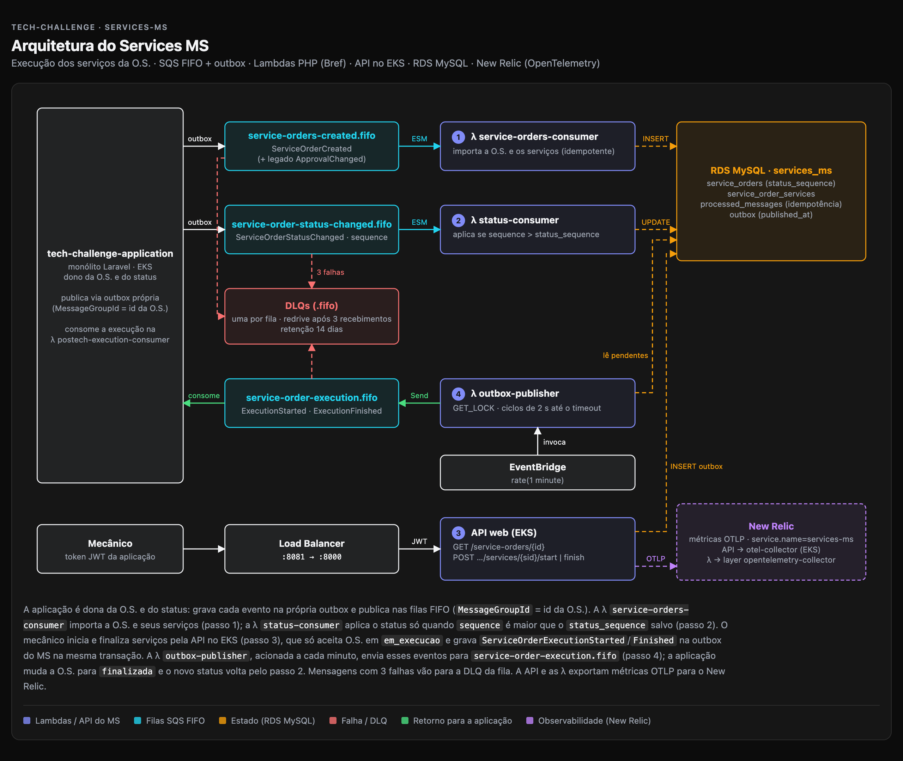

# tech-challenge-services-ms

Microsserviço de **execução dos serviços da O.S.** do POS Tech Challenge: registra o início e o fim de cada serviço
e avisa a aplicação quando a execução da O.S. termina. O status da O.S. pertence à aplicação; o MS mantém uma cópia somente leitura.

Laravel 12 · PHP 8.4 · SQS FIFO + outbox · Lambdas via [Bref](https://bref.sh) · API no EKS · RDS MySQL · New Relic (OpenTelemetry).



---

## Arquitetura

```
tech-challenge-application (dono da O.S. e do status)
   │ outbox
   ├──> SQS service-orders-created.fifo ───────> λ services-ms-service-orders-consumer ─┐
   │      ServiceOrderCreated (+ legado ApprovalChanged)   importa O.S. + serviços       │
   │                                                                                    ├──> RDS MySQL services_ms
   └──> SQS service-order-status-changed.fifo ─> λ services-ms-status-consumer ─────────┤    service_orders, service_order_services,
          ServiceOrderStatusChanged (sequence)    aplica se sequence > status_sequence   │    processed_messages, outbox
                                                                                        │
Mecânico ──JWT──> LB :8081 ──> API web (EKS, services-ms-web) ──────────────────────────┤
                               start/finish → grava ExecutionStarted/Finished na outbox │
                                                                                        │
EventBridge rate(1 min) ──> λ services-ms-outbox-publisher ──(lê outbox)────────────────┘
                               └──> SQS service-order-execution.fifo ──> aplicação (finalizada)
```

- **Entrada**: `service-orders-created` (criação da O.S.) e `service-order-status-changed` (cada `ServiceOrderStatusChanged` da aplicação).
- **Saída**: `service-order-execution`, via outbox, com `ServiceOrderExecutionStarted` e `ServiceOrderExecutionFinished`.
- **API** (JWT HS256, mesmo `JWT_SECRET` do monólito): `GET /service-orders/{id}`, `POST /service-orders/{id}/services/{sid}/start|finish`. Não há rota para alterar o status.
- O workflow deste repositório publica a imagem e implanta a API pelos manifests em `k8s/`. Os consumers e o publisher são Lambdas criadas pelo Terraform em `infra/`.

### Lambdas (consumers e publisher)

Os workers rodam em Lambda com PHP 8.4 via Bref (`bref/laravel-bridge`), reaproveitando os casos de uso de `app/Application`. Os handlers ficam em `app/Lambda`:

| Lambda | Handler | Gatilho |
|---|---|---|
| `services-ms-service-orders-consumer` | `App\Lambda\ServiceOrdersCreatedHandler` | Event source mapping da fila `service-orders-created` |
| `services-ms-status-consumer` | `App\Lambda\ServiceOrderStatusChangedHandler` | Event source mapping da fila `service-order-status-changed` |
| `services-ms-outbox-publisher` | `App\Lambda\PublishOutboxHandler` | EventBridge `rate(1 minute)` |

- Consumers: as mensagens com falha (inválidas ou erros transitórios) voltam por `batchItemFailures`. Após 3 recebimentos, o redrive manda a mensagem para a DLQ. Em filas FIFO, o processamento para na primeira falha do lote e devolve também as mensagens seguintes, para não quebrar a ordem.
- Publisher: cada invocação publica em ciclos de 2 s até 10 s antes do timeout (60 s). Um `GET_LOCK` no MySQL garante um único publisher, mesmo com invocações sobrepostas.
- Concorrência: a conta tem limite de 10 execuções simultâneas, então não há reserved concurrency. Cada event source mapping tem `maximum_concurrency = 2`.
- Rede: as Lambdas rodam fora da VPC e acessam o RDS público do laboratório, cujo SG `rds` libera a 3306. Assim alcançam o SQS sem NAT nem VPC endpoint.
- Pacote: `scripts/build-lambda.sh` monta `build/lambda` com `composer install --no-dev`, e o Terraform compacta esse diretório. O CI roda o script antes do `terraform plan`. Para aplicar localmente, rode o script antes (exige PHP 8.4 e Composer). O `composer.json` mantém só o serviço SQS do `aws-sdk-php` para reduzir o pacote.
- Layer: `arn:aws:lambda:us-east-1:534081306603:layer:php-84:<versão>`, definida em `var.bref_php_layer_version`. Ao atualizar o `bref/bref`, use a versão de `vendor/bref/bref/layers.json`.

### Fluxo de status

1. A aplicação grava o status e um `ServiceOrderStatusChanged` na outbox, na mesma transação. O campo `sequence` é o id da linha na outbox da aplicação. Esse id cresce a cada evento da O.S.
2. O MS aplica o evento somente se `sequence` for maior que o `status_sequence` salvo. Eventos repetidos ou antigos são ignorados.
3. Um serviço só pode ser iniciado com a O.S. em `em_execucao`. O primeiro início gera `ServiceOrderExecutionStarted`. A conclusão do último serviço gera `ServiceOrderExecutionFinished`. Os dois eventos carregam o `status_sequence` do momento.
4. A aplicação ignora `ServiceOrderExecutionStarted`, pois a aprovação já leva a O.S. para `em_execucao`. Ela aplica `ServiceOrderExecutionFinished` e muda para `finalizada` somente se a O.S. ainda estiver em `em_execucao` e se `status_sequence` for o último evento de status dela. Se a aplicação mudou o status depois disso, o evento é descartado. A mudança para `finalizada` volta ao MS como um novo `ServiceOrderStatusChanged`.

O.S. sem `status_sequence` (importadas antes desta mudança) recusam início/fim com 422 até receberem um evento de status. Para isso, rode `services-ms:sync-service-order-status` na aplicação (ver "Corte" abaixo). Os eventos legados `ServiceOrderApprovalChanged` ainda são aceitos na fila de criação, mas só alteram O.S. que ainda não têm `status_sequence`.

Status (enum `ServiceOrderStatus`): `recebida` → `em_diagnostico` ⇄ `aguardando_aprovacao` → `em_execucao` → `finalizada` → `entregue`.

---

## Pré-requisitos

| Ferramenta | Versão | Uso |
|---|---|---|
| Docker + Compose | recente | ambiente local (PHP 8.4 + MySQL 8) |
| PHP + Composer | 8.4 / 2.x | rodar testes fora do Docker e montar o pacote das Lambdas |
| Terraform | ≥ 1.10 (CI usa 1.10.5) | `infra/` |
| AWS CLI v2 + kubectl | recente | operar Lambdas, SQS e o cluster `main` |
| GitHub CLI (`gh`) | opcional | disparar workflow e configurar secrets |

---

## Desenvolvimento local com Docker

Copie `.env.example` para `.env` se ainda não existir e defina nele uma senha
local não vazia para `SERVICES_MS_DB_PASSWORD`. Não compartilhe o arquivo `.env`.
Depois execute:

```bash
docker compose build
docker compose run --rm php composer install
# Somente se APP_KEY ainda não estiver configurada:
docker compose run --rm php php artisan key:generate
docker compose run --rm php php artisan config:clear
docker compose run --rm php php artisan migrate
docker compose up -d
```

A API fica em `localhost:8000`, o MySQL em `127.0.0.1:3307` e o LocalStack em
`localhost:4566`. No container, a aplicação usa o banco `services_ms` em `db`
e as filas do LocalStack. A senha é aplicada na primeira criação do volume
MySQL; alterá-la no `.env` não atualiza um banco já inicializado. O Compose
inicia somente a API; os consumers e o publisher existem apenas como Lambdas
(`app/Lambda`) e são cobertos por `tests/Feature/LambdaHandlersTest.php`.

> O serviço `localstack` está comentado no `docker-compose.yml`. Para usar filas locais, descomente-o;
> `docker/localstack/init-sqs.sh` cria as filas FIFO.

Atalhos do `Makefile`: `make up`, `make down`, `make logs`, `make test`, `make lint` (Pint), `make build`.

### Testes

```bash
docker compose exec php php artisan test   # ou: make test
php artisan test                            # fora do Docker (exige PHP 8.4)
```

O CI roda os mesmos testes (PHPUnit com o `.env.example`) e `terraform fmt -check` + `terraform validate`.

---

## API

Todas as rotas exigem `Authorization: Bearer <JWT>` (HS256, claim `sub` = id do usuário). Sem token ou com assinatura inválida → `401`.

| Método | Rota | Resposta |
|---|---|---|
| `GET` | `/service-orders/{id}` | O.S. + serviços |
| `POST` | `/service-orders/{id}/services/{serviceId}/start` | O.S. atualizada; `422` se a O.S. não está em `em_execucao`, o serviço já foi iniciado ou o status ainda não foi sincronizado |
| `POST` | `/service-orders/{id}/services/{serviceId}/finish` | O.S. atualizada; `422` se o serviço não foi iniciado ou já foi finalizado |
| `GET` | `/up` | health check (probes do Kubernetes) |

```bash
# Endereço do LoadBalancer no EKS (porta 8081)
HOST=$(kubectl get svc services-ms-web -n services-ms -o jsonpath='{.status.loadBalancer.ingress[0].hostname}')
curl -s "http://$HOST:8081/service-orders/<id>" -H "Authorization: Bearer $TOKEN"
```

O token é emitido pela aplicação (mesmo `JWT_SECRET`). A collection Bruno está em [`bruno/`](bruno/README.md).

---

## Infraestrutura

O Terraform em `infra/` consulta a VPC `main` e as subnets `sub_a`/`sub_b` do
repositório Kubernetes com data sources. O RDS do MS usa essa VPC; a configuração
habilita acesso público e permite MySQL na porta 3306
a partir de qualquer endereço IPv4, além do CIDR da VPC. Essa exposição foi
solicitada apenas para o laboratório e não deve ser usada em produção. Restrinja
os endereços autorizados e rotacione credenciais comprometidas antes de expor
o banco. A configuração ainda precisa ser aplicada após revisão do plano.

O RDS atual está na VPC antiga. A próxima aplicação do Terraform substituirá o
banco e removerá os recursos de rede exclusivos do MS; os dados não são
migrados para o novo RDS. Não aplique antes de revisar o plano e confirmar que
o conteúdo do banco antigo pode ser descartado. Após a substituição, atualize o
GitHub Actions Secret `DB_HOST` com o endpoint novo e confirme que
`DB_USERNAME`/`DB_PASSWORD` correspondem ao RDS criado antes do deploy.

O workflow atual executa `terraform apply` automaticamente em pushes para
`main` e execuções manuais nessa branch. Não o dispare antes de reconciliar o
state e revisar e autorizar o plano, incluindo os efeitos no RDS.

### Terraform local

```bash
scripts/build-lambda.sh                 # obrigatório: o Terraform compacta build/lambda
cd infra
terraform init -reconfigure             # backend S3 techchallenge-tfstate-477478162709-v2
terraform plan -var=enable_pod_identity=true -out=tfplan
terraform apply tfplan                  # só após revisar o plano
terraform output                        # URLs das filas, endpoint do RDS, nomes das Lambdas
```

Variáveis sem default: `db_password`, `jwt_secret` (use `TF_VAR_*`; arquivos `*tfvars*` estão no `.gitignore`).
Opcionais: `new_relic_license_key` (liga as métricas das Lambdas), `bref_php_layer_version`, `otel_collector_layer_version`.

---

## Deploy no EKS (CI/CD)

`.github/workflows/ci-cd.yml`:

| Evento | Jobs |
|---|---|
| Pull request para `main` | `test` (PHPUnit) + `terraform` (fmt/validate) |
| Push em `main` / `workflow_dispatch` em `main` | + `terraform_apply` (build das Lambdas, plan, remove workers antigos do EKS, apply) → `build` (imagem GHCR `:<sha>` e `:latest`) → `deploy` |

O job `deploy` aplica namespace, ConfigMap e Secrets, sobe o `otel-collector`, roda o Job de migrations
(com diagnóstico sem expor Secrets em caso de falha) e faz o rollout de `services-ms-web` + HPA.

### Secrets do repositório

| Secret | Uso |
|---|---|
| `AWS_ACCESS_KEY_ID`, `AWS_SECRET_ACCESS_KEY` | runner (Terraform e kubectl). Nunca vão para os Secrets dos Pods |
| `DB_HOST` | ConfigMap da API (endpoint do RDS) |
| `DB_USERNAME`, `DB_PASSWORD` | Secret `services-ms-secret`; `DB_PASSWORD` também é `TF_VAR_db_password` |
| `APP_KEY` | Secret `services-ms-secret` |
| `JWT_SECRET` | Secret `services-ms-secret` e `TF_VAR_jwt_secret` — o mesmo da aplicação |
| `GHCR_USERNAME`, `GHCR_TOKEN` | `ghcr-secret` para pull da imagem privada |
| `NEW_RELIC_LICENSE_KEY` | `TF_VAR_new_relic_license_key` (Lambdas) e `otel-collector-secret` (EKS) |

As Lambdas recebem a configuração do banco e da fila pelo Terraform, não pelos Secrets do Kubernetes.

### Identidade IAM

Cada Lambda tem sua própria role IAM com acesso mínimo: o consumer só recebe da
fila de criação, o status consumer só recebe da fila de status e o publisher só
envia à fila de execução. Os workers da aplicação também viraram Lambdas
(`tech-challenge-kubernetes/app-lambda`). Com isso, nenhum workload do EKS
usa Pod Identity: `pod_identity_workloads` está vazio e o Terraform só cria o
agente quando `enable_pod_identity = true`. A configuração vem desativada por padrão
(`enable_pod_identity = false`) no Terraform; o CI passa explicitamente
`enable_pod_identity = true` no plano para preservar as associações.

Antes de habilitar, um administrador deve conceder ao operador as permissões
para criar roles/policies e fazer `iam:PassRole`. O agente também exige
`eks-auth:AssumeRoleForPodIdentity` na role dos nodes e acesso à API EKS Auth.
Na verificação do laboratório houve negação explícita dessa ação para a role
dos nodes; uma permissão adicional não supera uma negação explícita. Resolva
esse bloqueio antes do apply. Verifique também se o addon já existe: caso seja
gerenciado fora deste Terraform, concilie sua propriedade antes de habilitar.

Em execuções manuais do Terraform, mantenha `enable_pod_identity = true` para
evitar a remoção das associações. A política temporária existente
das filas para a role dos nodes permanece até uma remoção planejada e
autorizada; enquanto estiver ativa, não há isolamento completo dos demais
pods. Nunca injete credenciais do runner nos Secrets dos pods.

### Execução manual

Os três workflows de build/deploy aceitam execução manual (`workflow_dispatch`)
na branch selecionada:

- `tech-challenge-application`: execute o build da branch; ele publica a tag da
  branch e o SHA, sem atualizar `latest` nem disparar deploy automático fora de
  `main`.
- `tech-challenge-services-ms`: a execução manual testa, publica a imagem pelo
  SHA e faz deploy dessa versão no EKS compartilhado.
- `tech-challenge-kubernetes`: execute o deploy manual informando em `image_tag`
  a tag da imagem (ou SHA). Mantenha `enable_services_ms=false` até o MS estar
  implantado e saudável.

Os deploys manuais do Services MS e Kubernetes alteram o cluster EKS
compartilhado; revise a branch e a tag antes de iniciá-los.

```bash
gh workflow run ci-cd.yml --ref main
gh run watch
```

---

## Integração com o tech-challenge-application

A aplicação só publica eventos para o MS com `SERVICES_MS_ENABLED=true` (`config/services_ms.php` na aplicação).
Comandos da aplicação usados na integração: `services-ms:backfill-service-orders` (importa O.S. existentes) e
`services-ms:sync-service-order-status` (envia o status atual de cada O.S.).

### Corte (uma única vez)

A fila `service-order-status-changed` inverteu de sentido: antes ia do MS para a aplicação e agora vai da aplicação para o MS. Ordem recomendada:

1. Aplique o Terraform em `infra/` para criar `service-order-execution.fifo` e sua DLQ. Cadastre o secret `SQS_SERVICE_ORDER_EXECUTION_URL` neste repositório.
2. Com a aplicação ainda na versão antiga, pare o outbox antigo do MS (`kubectl scale deployment services-ms-outbox -n services-ms --replicas=0`). Espere a fila `service-order-status-changed` esvaziar, ou seja, o consumidor antigo da aplicação processar o que restou.
3. Implante o MS. O workflow remove os workers antigos do EKS (`services-ms-consumer`, `services-ms-outbox`, `services-ms-status-consumer`) antes do `terraform apply`, que cria as Lambdas. A migration `discard_legacy_status_outbox_events` marca como publicados os `ServiceOrderStatusChanged` antigos ainda pendentes na outbox do MS. Sem isso, o grupo da O.S. ficaria bloqueado no publisher. Atenção: o workflow roda as migrations no job de deploy, depois do `terraform apply`. Até elas terminarem, as Lambdas podem falhar por falta da coluna `status_sequence`, e as mensagens com 3 falhas vão para a DLQ. No corte, rode as migrations antes do apply ou faça o redrive da DLQ depois.
4. Implante a aplicação pelo repositório Kubernetes. O workflow remove `postech-status-consumer` e os workers antigos da aplicação antes de aplicar a nova imagem. No mesmo workflow, depois das migrations, o job `lambdas` cria as Lambdas `postech-outbox-publisher` e `postech-execution-consumer` (`tech-challenge-kubernetes/app-lambda`). Confirme que `SERVICES_MS_ENABLED=true`, senão a aplicação não publica eventos.
5. Na aplicação, rode `php artisan services-ms:backfill-service-orders` para O.S. ainda não importadas e depois `php artisan services-ms:sync-service-order-status`.
6. Verifique as DLQs. Mensagens antigas no formato anterior, sem `sequence`, que chegarem ao novo consumidor do MS vão para a DLQ após 3 tentativas e podem ser descartadas.

---

## Monitoramento

### New Relic (OpenTelemetry)

O MS não usa o agente PHP do New Relic. Ele exporta métricas OTLP (temporalidade delta) para um OpenTelemetry Collector, que repassa ao New Relic:

```
API web (EKS) ──OTLP──> otel-collector (Deployment, k8s/03-observability) ──┐
Lambdas ──OTLP localhost──> layer opentelemetry-collector (extension) ──────┴──> otlp.nr-data.net
```

- Secret necessário: `NEW_RELIC_LICENSE_KEY` (a mesma do `nri-bundle` no repositório Kubernetes). Sem ela, as Lambdas sobem sem a layer do collector.
- Métricas de negócio (`service_order.*`), mensageria (`messaging.*`, `outbox.publish.lag`) e HTTP (`http.server.request.duration`), todas com `service.name = 'services-ms'`. Sem IDs de O.S./cliente/veículo nos atributos.
- Conta New Relic `8497993`. Só exporta com `OTEL_METRICS_EXPORTER=otlp` (padrão `none`, usado em dev e nos testes).

| Métrica | Tipo | Atributos | Origem |
|---|---|---|---|
| `service_order.received` | counter | `service_order.status` | O.S. importada (`ServiceOrderCreated`) |
| `service_order.status.transitions` | counter | `service_order.previous_status`, `service_order.status`, `service_order.event_type` | status aplicado no MS |
| `service_order.service.started` / `.finished` | counter | — | início/fim de serviço pela API |
| `service_order.service.duration` | histogram (s) | — | início → fim de um serviço |
| `service_order.execution.duration` | histogram (s) | — | primeiro início → último fim da O.S. |
| `service_order.execution.rejected` | counter | `service_order.operation` (`start`/`finish`) | regra de negócio recusou (422) |
| `messaging.process.duration` | histogram (s) | `messaging.destination.name`, `service_order.event_type`, `outcome` (`processed`/`skipped`/`invalid`/`failed`), `error.type` | cada mensagem SQS consumida |
| `messaging.client.sent.messages` | counter | `messaging.destination.name`, `service_order.event_type`, `error.type` | publicação da outbox |
| `outbox.publish.lag` | histogram (s) | idem | gravação na outbox → envio ao SQS |
| `http.server.request.duration` | histogram (s) | `http.request.method`, `http.route`, `http.response.status_code` | rotas da API (sem `/up`) |

```sql
FROM Metric SELECT sum(service_order.status.transitions) WHERE service.name = 'services-ms' FACET service_order.status TIMESERIES
FROM Metric SELECT count(messaging.process.duration) WHERE service.name = 'services-ms' FACET outcome, messaging.destination.name
FROM Metric SELECT percentile(outbox.publish.lag, 50, 95) WHERE service.name = 'services-ms' TIMESERIES
-- Validar se as métricas chegam
FROM Metric SELECT count(*) WHERE service.name = 'services-ms' SINCE 30 minutes ago FACET metricName
```

Sem métricas da API: `kubectl logs deploy/otel-collector -n services-ms` e o Secret `otel-collector-secret`.
Sem métricas das Lambdas: confira a layer do collector e `OTEL_METRICS_EXPORTER=otlp` em
`aws lambda get-function-configuration --function-name services-ms-status-consumer`.

### Logs das Lambdas

```bash
# nomes: service-orders-consumer, status-consumer, outbox-publisher
aws logs tail /aws/lambda/services-ms-status-consumer --follow
aws logs tail /aws/lambda/services-ms-service-orders-consumer --since 1h --filter-pattern "Invalid SQS message"
```

### Logs da API

```bash
kubectl logs deploy/services-ms-web -n services-ms --tail=100 -f
kubectl get pods,hpa -n services-ms
```

### Mensagens na DLQ

```bash
cd infra && terraform output sqs_dlq_urls
aws sqs get-queue-attributes --queue-url <dlq_url> --attribute-names ApproximateNumberOfMessages
aws sqs receive-message --queue-url <dlq_url> --max-number-of-messages 10
# Reprocessar (redrive de volta para a fila de origem)
aws sqs start-message-move-task --source-arn <dlq_arn>
```

---

## Troubleshooting

| Sintoma | Causa provável | O que fazer |
|---|---|---|
| `start`/`finish` → 422 "status has not been synchronized" | O.S. sem `status_sequence` | Na aplicação: `php artisan services-ms:sync-service-order-status` |
| `start` → 422 "Cannot start a service while the order is …" | O.S. ainda não aprovada | Aprovar o orçamento na aplicação; o status chega pela fila de status |
| 401 em todas as rotas | `JWT_SECRET` diferente do monólito ou token sem `sub` | Conferir o secret `JWT_SECRET` nos dois repositórios |
| Mensagens indo para a DLQ logo após o deploy | Migrations ainda não rodaram (coluna `status_sequence`) | Esperar o Job `services-ms-migrate` e fazer redrive da DLQ |
| Status nunca chega ao MS | `SERVICES_MS_ENABLED=false` na aplicação | Ligar a flag e rodar o sync |
| Outbox não publica | `SQS_SERVICE_ORDER_EXECUTION_URL` ausente na Lambda ou outro publisher com o lock | `aws logs tail /aws/lambda/services-ms-outbox-publisher`; consultar `outbox` com `published_at IS NULL` |
| Job de migração falha no deploy | credenciais/host do RDS | O passo "Run migrations" imprime o diagnóstico (SQLSTATE, DNS, timeout); conferir `DB_HOST`/`DB_USERNAME`/`DB_PASSWORD` |
| `terraform plan` falha em `archive_file` | `build/lambda` não existe | Rodar `scripts/build-lambda.sh` antes |
| Nenhuma métrica no New Relic | `NEW_RELIC_LICENSE_KEY` ausente ou collector parado | Ver "Monitoramento" acima |

---

## Estrutura do repositório

```
tech-challenge-services-ms/
├── app/
│   ├── Application/
│   │   ├── Execution/ServiceOrderExecution.php      # start/finish + eventos na outbox
│   │   ├── Outbox/OutboxPublisher.php               # outbox → service-order-execution.fifo (GET_LOCK)
│   │   ├── ServiceOrder/Process*.php                # consumers: Created, StatusChanged, ApprovalChanged (legado)
│   │   └── Telemetry/Metrics.php                    # métricas OpenTelemetry
│   ├── Domain/ServiceOrder/                         # ServiceOrder, ServiceOrderService, ServiceOrderStatus
│   ├── Http/Controllers/ServiceOrderExecutionController.php
│   ├── Http/Middleware/                             # VerifyJwt, RecordHttpMetrics
│   ├── Infrastructure/                              # repositórios Eloquent, MeterProviderFactory
│   └── Lambda/                                      # handlers Bref (FifoSqsHandler + 3 Lambdas)
├── database/migrations/                             # service_orders, services, processed_messages, outbox
├── routes/api.php                                   # rotas JWT (sem prefixo /api)
├── config/telemetry.php                             # OTLP
├── infra/                                           # Terraform: SQS, RDS, Lambdas, Pod Identity
│   └── tests/pod_identity.tftest.hcl
├── k8s/
│   ├── 00-namespace/  01-config/                    # namespace, ConfigMap (placeholders preenchidos pelo CI)
│   ├── 02-app/                                      # web, HPA + LB :8081, Job de migrations
│   └── 03-observability/otel-collector.yaml
├── otel/lambda-collector.yaml                       # config do collector das Lambdas
├── scripts/build-lambda.sh                          # monta build/lambda
├── bruno/                                           # collection da API
├── docs/architecture.png                         # diagrama da arquitetura
├── tests/                                           # PHPUnit (Feature + Unit)
├── CLAUDE.md                                        # contexto para o Claude Code
├── .claude/skills/skills.md                         # playbooks do Claude Code
└── .github/workflows/ci-cd.yml                      # test → terraform → build → deploy
```
